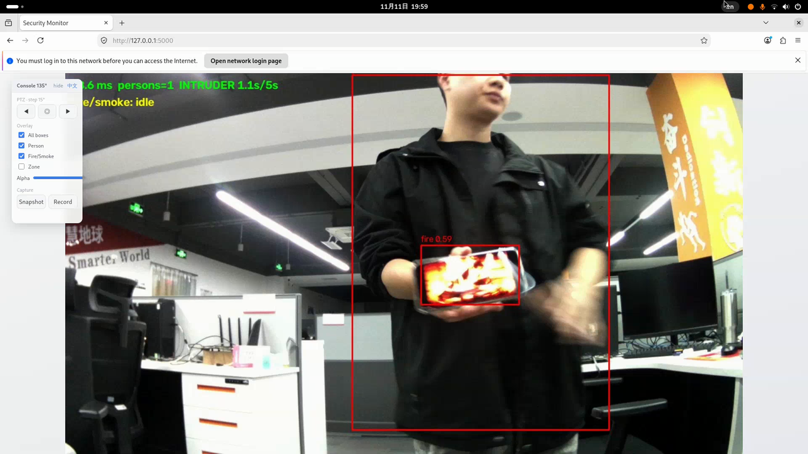
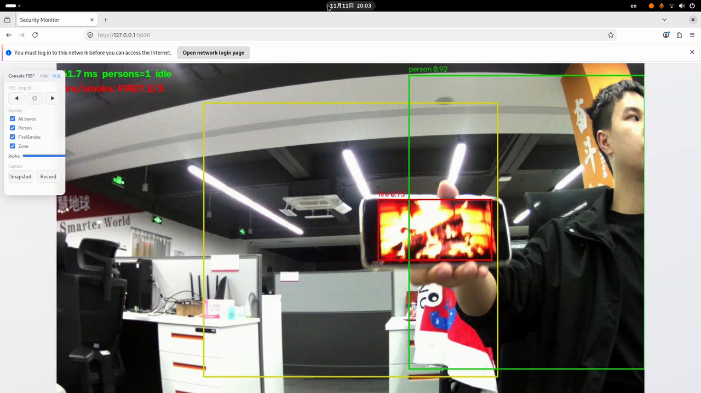

# Security Equipment

[中文](README.zh-CN.md) | English

This project is a security-monitoring and fire-detection demo implemented on the [Quectel Pi M2 Smart Single-Board Computer](https://www.quectel.com.cn/quectel-pi/documentation-center). A USB camera streams live video while two RKNN models run in parallel on the dual-core NPU: one detects people (intrusion-zone alarms), the other detects fire and smoke. A servo pan-tilt, a Web console, and automatic local forensics complete the loop. All processing runs on-device — no cloud dependency.



## Features

- Real-time person detection with a configurable intrusion zone (5 s dwell triggers the alarm)
- Fire & smoke detection (YOLOv5 model trained on the open D-Fire dataset), tiered alarms plus a static-target false-positive fuse
- Web console at `http://<board-ip>:5000`: live video, pan-tilt buttons (◀ ◎ ▶), overlay toggles & opacity slider, snapshot & record — EN/中文 switchable
- Automatic forensics on every alarm: snapshot + 10 s clip (5 s before, 5 s after), with file rotation
- LED / buzzer alarm output, timestamped categorized terminal log mirrored to `records/logs/run.log`
- ZP15S bus servo controlled over UART (ASCII commands, no PWM driving required)
- Pure Python, zero C compilation; NPU inference on RK3576

## Hardware Requirements

- Quectel Pi M2 single-board computer (factory Debian 13 image)
- USB UVC camera (1080p MJPG recommended)
- ZP15S bus servo as camera pan-tilt: signal → PIN 8, GND → PIN 6, VCC 5V → PIN 4
- 5 V ≥ 3 A power adapter (a PC USB port cannot power board + servo)
- HDMI display / keyboard & mouse: optional, the demo is watched in a browser

## Software Environment

- OS: Debian 13 (default image of Quectel Pi M2)
- Python: 3.12 with rknnlite — **not preinstalled on a fresh board**; `tools/setup.sh` bootstraps it automatically (network required)

## Quick Start

1. Clone the project on the board:

```bash
sudo apt update && sudo apt install -y git
git clone https://github.com/Quectel-Pi/demo-security-equipment.git
cd demo-security-equipment
```

2. One-click environment setup (installs Python 3.12 + rknnlite + dependencies, enables UART1 for the servo):

```bash
sudo sh tools/setup.sh
sudo reboot          # only if setup.sh reports UART1 was just enabled
```

3. Run, then open `http://<board-ip>:5000` in a browser:

```bash
sh start.sh            # full function, alarm output on
sh start.sh --no-alarm # observation only
```

A healthy launch prints one `[启动] OK` status line per component. Optionally verify the environment first:

```bash
/opt/py312/bin/python3.12 tools/check_env.py
```



## Project Structure

```
demo-security-equipment/
├── start.sh             # single entry point
├── config.yaml          # all tunables (camera / detection / alarm / record / servo / overlay)
├── src/                 # source code
│   ├── main.py          # capture + inference + scheduling
│   ├── camera/          # V4L2 camera (auto-detect by device name)
│   ├── vision/          # RKNN inference (person / fire-smoke)
│   ├── logic/           # intrusion & tiered-alarm rules
│   ├── io/              # LED/buzzer, Flask console + APIs, forensic recorder, applog
│   └── servo/           # ZP15S UART driver
├── models/              # production RKNN models
├── tools/               # check_env.py / setup.sh / diagnostics
└── images/              # README assets
```

## Models

- `yolo_pose.rknn` — person detection, from the Quectel Pi M2 SDK examples
- `dfire_yolov5s.rknn` — fire & smoke detection, converted from a YOLOv5 model pretrained on [D-Fire](https://github.com/gaia-solutions-on-demand/DFireDataset) (~21k open-source images, includes negative samples)

## Configuration & Documentation

Every runtime parameter — detection thresholds, intrusion polygon, overlay visibility, forensic rotation, servo step — lives in `config.yaml`. Wiring photos, the full parameter guide, UI details and FAQ are maintained in the [Quectel Pi documentation center](https://www.quectel.com.cn/quectel-pi/documentation-center).

## Reporting Issues

If you encounter any issues during use, please submit technical inquiries on the [Quectel Official Forum](https://forumschinese.quectel.com/c/quectel-pi/58). Our technical support team will respond promptly.

Issues and Pull Requests are welcome to help improve this project.
