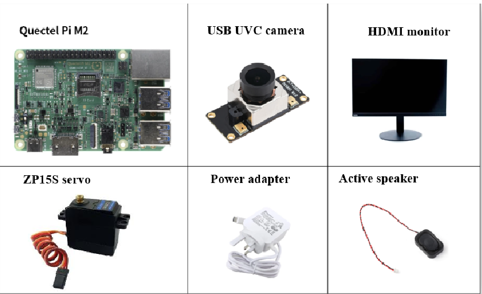
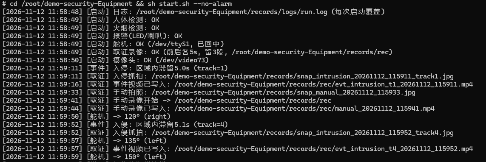
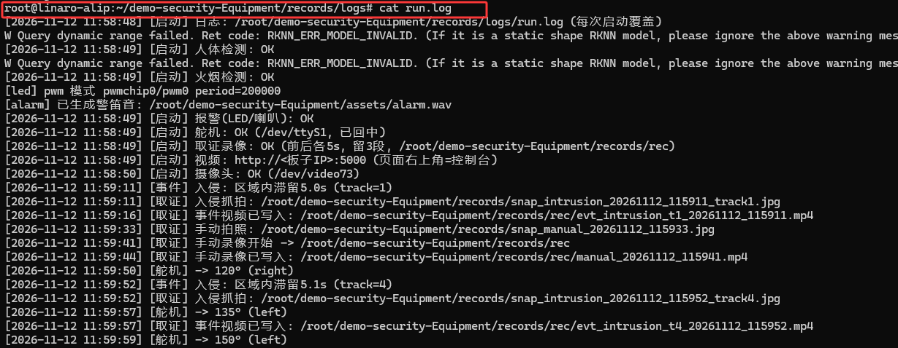
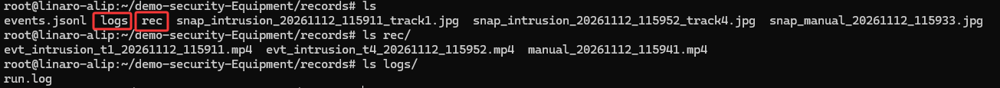
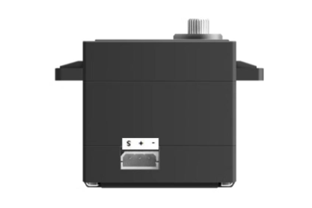

# Security Equipment

[简体中文](README.zh-CN.md) | [English](README.md)

***Copyright © Quectel Wireless Solutions Co\., Ltd\. 2026\. All rights reserved\.***

---

# Revision History

|Version|Date|Author|Change Description|
|---|---|---|---|
|\-|2026\-11\-11||Document created|
|0\.1|2026\-11\-11||Temporary version|

# Overview

This project is an example of security monitoring and fire detection based on the Quectel Pi M2 smart main control board, a USB camera, and a servo\. 

The project is based on Python and a Web interface, uses YOLO v8 to train models on open\-source datasets, can accurately identify people and flames within the specified range of the camera, and after the specified warning time is reached, emits an alarm sound and records the footage before and after the event\. It also provides a servo to adjust the camera's field of view\.


# Development Materials

## Bill of Materials

> Note:tips
> 
> The development accessories are for reference only\. Different development environments may vary\.
> 
> 

|**Accessory Name**|**Quantity**|**Specification or Description**|
|---|---|---|
|Quectel Pi M2 smart main control board|1 |Main control|
|USB UVC camera|1 |Recommended to support 1080p MJPG, connected via the M2's USB 3\.0 interface|
|HDMI monitor|1 |Desktop demonstration|
|USB keyboard and mouse|1 |For operating the desktop APP, optional|
|ZP15S servo|1|Used for camera rotation|
|Power adapter|1|Select according to the power supply requirements of Quectel Pi M2|
|Active speaker or loudspeaker|1|For demonstrating alarm sound, optional|

## Reference Photos of Accessories



# Quick Start

## Development Preparation

The Quectel Pi M2 smart main control board comes with the Debian 13 system image by default\. You can start development directly by following the steps below\.

## Hardware Connection

1. **M2 power connection: USB\-C power**

2. **Module connection:**

|**Servo**|**M2**|
|---|---|
|VCC \- 5V|PIN 4|
|GND|PIN 6|
|RX|PIN 8|

## Project Implementation

### Obtain the Code

Use git to clone the project code\. The git repository address is as follows:

```Bash
git clone https://github.com/Quectel-Pi/demo-security-equipment.git
```

After execution, the file directory is as follows:

```Bash
demo-security-equipment/
├── README.md / README.zh-CN.md
├── start.sh             Entry script
├── config.yaml          Configuration file
├── src/
│   ├── main.py
│   ├── camera/
│   │   └── capture.py       V4L2 camera: auto-lookup by device name + liveness detection
│   ├── vision/
│   │   ├── pose_detector.py   Human pose inference (runs yolo_pose.rknn)
│   │   └── fire_smoke.py      Flame & smoke inference (runs dfire_yolov5s.rknn)
│   ├── logic/
│   │   ├── intrusion.py       Intrusion judgment: trigger alarm when staying in zone for 5 seconds
│   │   └── fire_alarm.py      Graded alarm: continuous flame hits / smoke window counter / static anti-false-positive fuse
│   ├── io/
│   │   ├── alarm.py           Alarm output: LED + buzzer
│   │   ├── stream.py          Web service: video streaming + API + web console page
│   │   └── recorder.py        Evidence collection: snapshot capture / event log / pre & post alarm video clips
│   └── servo/
│       └── servo_zp.py        ZP15S servo driver
├── models/              Vision model files
├── assets/              Alarm audio (alarm.wav, auto-generated on first board startup)
├── tools/
│   ├── check_env.py         Environment checker: verify Python, dependencies, camera and model files item by item
│   ├── setup.sh             One-click setup: auto-install missing dependencies + enable UART1
│   ├── fire_lab.py          Flame & smoke model field tester: per-frame score and motion statistics
│   ├── peek_model.py        RKNN model inspector: inspect input size and output layout for unknown models
│   └── zp_test.py           Standalone servo test: verify rotation without launching the main program
└── records/ (auto-generated on board)    Captured JPGs, event log events.jsonl, evidence video rec/ with auto rotation   
```

### Verify Environment

Check the environment for python, camera, numpy, etc\.

```Bash
cd demo-security-equipment/

# 1.One-click configuration
sudo sh tools/setup.sh

# 2.Check configuration
/opt/py312/bin/python3.12 tools/check_env.py
```

### Run the Program

After executing the program, open the browser address to see the screen:[http://127\.0\.0\.1:5000/](http://127.0.0.1:5000/)

```Bash
# 1.Full functionality
sh start.sh

# 2.Silent version
sh start.sh --no-alarm
```

### File Configuration

Necessary parameters can be modified through config\.yaml, for example:

```Bash
# Web display box parameters
display:
  show_boxes: true              # Master switch for boxes: false = no recognition boxes are drawn on the screen (including zone boxes)
  show_person: true             # Person box
  show_fire: true               # Flame/smoke box
  show_zone: true               # Arming zone box line (warning range)
  line_width: 2                 # Box line width (set to 1 for a thinner line)
  font_scale: 0.55              # Font size of labels on boxes
  box_alpha: 1.0                # Box line opacity 0.2~1.0 (around 0.6 = semi-transparent watermark effect)
  
# Recording
record:
  save_dir: records             # Snapshot jpg + events.jsonl
  enabled: true
  rec_dir: records/rec          # Recording output folder (forensic + manual; absolute path such as /userdata/rec can be written)
  pre_s: 5                      # Duration before alarm
  post_s: 5                     # Duration after alarm
  fps: 10
  keep_files: 3                 # Forensic recordings keep only the latest 3 segments; the 4th segment automatically overwrites the oldest when written to disk
  manual_keep: 15               # Manual recordings keep only the latest 15 segments (single segment limit 10 minutes)
```

After the configuration is complete, restart the demo and force\-refresh the page\.

### Logging System

Logs in this demo are categorized into **Event Logs** and **Visual Logs**:

**Event Logs** include:

1. Real-time terminal logs: Continuously print messages to the terminal after program startup.

2. File-based logs: Synchronously write to `run.log` after startup. The log from the previous run will be overwritten each time the program restarts.

3. Event JSON logs: `record/event.jsonl`. Only alarm events are recorded. One JSON object per line (timestamp / type / confidence / coordinates / snapshot filename). New entries are appended without overwriting existing content.





**Visual Logs** include:

1. Event evidence videos: `records/rec/evt_*.mp4`. **Only the latest 3 clips are kept**. The oldest clip will be automatically deleted once a 4th clip is generated.

2. Alert snapshots: `records/*.jpg`. One image is captured for each alarm trigger or manual photo capture.

3. Manual recordings: A maximum of 15 clips are retained. Each clip is capped at 10 minutes.



## UI Interface Description

It mainly consists of two parts: screen display and console:

1. The console can adjust the camera angle through the Left/Center/Right buttons;

2. The console can choose whether to enable various boxes on the screen and the opacity of the boxes;

3. The console can quickly capture photos or record a video;

4. When a person walks from outside the screen into the middle of the screen \(warning box\) for a period of time, the person box line changes from green to red and triggers an alarm;

5. When a flame appears on the screen, the flame part is framed and an alarm is triggered after a period of time\.


## Servo Pin Introduction

The ZP15S servo consists of data, VCC, and GND: data is connected to the board's UART port to read signals, and from left to right they are data, VCC, and GND\. If the servo manufacturer's wiring is used, the pairing is as follows:

Orange/white wire\-\-\-\-\-\-\-\-\-\-\-\-\-\-\- data

Red wire\-\-\-\-\-\-\-\-\-\-\-\-\-\-\-\-\-\-\- VCC

Brown/black wire\-\-\-\-\-\-\-\-\-\-\-\-\-\-\-\-\-\- GND




# FAQ and Solutions

## Camera misidentifies flame

The camera used in this case has a relatively low resolution, so in some overexposed situations it may cause the camera to abnormally identify flames and smoke\. Replacing it with a higher\-definition camera can solve this\. The training dataset comes from the open\-source community, so it can also be directly replaced with the user's own trained model\.

# Technical Support and Contributions

If you encounter any problems during use, you are welcome to submit technical inquiries on the [Quectel official forum](https://forumschinese.quectel.com/c/quectel-pi/58)\. Our technical support team will answer you promptly\.

You are also welcome to submit Issues to provide feedback or Pull Requests to contribute code improvements\!

