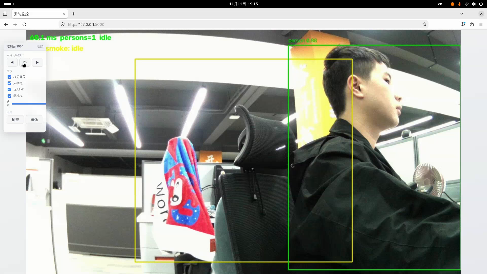

# 安防监控设备（Security Equipment）

[中文](README.zh-CN.md) | [English](README.md)

本项目是基于[移远 Quectel Pi M2 智能单板](https://www.quectel.com.cn/quectel-pi/documentation-center)的安防监控与火灾检测演示。USB 摄像头实时推流，双 RKNN 模型在双核 NPU 上并行运行：人体检测负责入侵区域报警，火烟检测负责明火与烟雾识别；舵机云台、Web 控制台与本地自动取证构成完整闭环。全程端侧处理，无云端依赖。



## 功能特性

- 实时人体检测 + 可配置入侵区域（滞留 5 秒触发报警）
- 明火/烟雾检测（基于开源 D-Fire 数据集训练的 YOLOv5 模型），分级报警 + 静态目标防误报保险丝
- Web 控制台（`http://<板子IP>:5000`）：实时画面、云台按键（◀ ◎ ▶）、框线开关与透明度滑条、拍照/录像，界面支持中英切换
- 报警自动取证：抓拍照片 + 前后各 5 秒共 10 秒短视频，带文件轮换
- LED/蜂鸣器报警输出；终端日志统一 `[时间][类别]` 格式并镜像至 `records/logs/run.log`
- ZP15S 总线舵机经 UART 控制（ASCII 命令协议，无需 PWM 驱动）
- 纯 Python 实现，零 C 编译；RK3576 NPU 端侧推理

## 硬件需求

- Quectel Pi M2 智能单板（出厂 Debian 13 镜像）
- USB UVC 摄像头（建议支持 1080p MJPG）
- ZP15S 总线舵机作摄像头云台：信号 → PIN 8，GND → PIN 6，VCC 5V → PIN 4
- 5V ≥ 3A 电源适配器（电脑 USB 口带不动"板 + 舵机"）
- HDMI 显示器 / 键鼠：可选，演示直接在浏览器观看

## 软件环境

- 操作系统：Debian 13（Quectel Pi M2 默认镜像）
- Python：3.12 + rknnlite——**出厂镜像未预装**，由 `tools/setup.sh` 自动引导安装（需联网）

## 快速开始

1. 在板子上克隆本工程：

```bash
sudo apt update && sudo apt install -y git
git clone https://github.com/Quectel-Pi/demo-security-equipment.git
cd demo-security-equipment
```

2. 一键环境配置（自动安装 Python 3.12 + rknnlite + 依赖库，并开启舵机所需 UART1）：

```bash
sudo sh tools/setup.sh
sudo reboot          # 仅当 setup.sh 提示 UART1 刚开启时需要
```

3. 启动，随后浏览器打开 `http://<板子IP>:5000`：

```bash
sh start.sh            # 全功能（报警输出开）
sh start.sh --no-alarm # 仅观察
```

正常启动会逐行打印每个组件的 `[启动] OK` 状态。可选先做一次环境体检：

```bash
/opt/py312/bin/python3.12 tools/check_env.py
```


## 目录结构

```
demo-security-equipment/
├── start.sh             # 唯一入口
├── config.yaml          # 全部可调参数（摄像头/检测/报警/取证/舵机/框线显示）
├── src/                 # 源码
│   ├── main.py          # 采集 + 推理 + 调度
│   ├── camera/          # V4L2 摄像头（按设备名自动定位）
│   ├── vision/          # RKNN 推理（人体 / 火烟）
│   ├── logic/           # 入侵判定与分级报警规则
│   ├── io/              # LED/蜂鸣、Flask 控制台与 API、取证录像、统一日志
│   └── servo/           # ZP15S UART 驱动
├── models/              # 板端推理模型
├── tools/               # check_env.py / setup.sh / 诊断工具
└── images/              # README 图片资源
```

## 模型说明

- `yolo_pose.rknn` — 人体检测，来自 Quectel Pi M2 SDK 官方示例
- `dfire_yolov5s.rknn` — 明火/烟雾检测，由 [D-Fire](https://github.com/gaia-solutions-on-demand/DFireDataset) 开源数据集（约 2.1 万张，含负样本）预训练 YOLOv5 权重转换而来

## 配置与文档

所有运行参数——检测阈值、入侵区域、框线显示、取证轮换、舵机步进——均集中在 `config.yaml`。接线实物图、完整参数指南、界面说明与 FAQ 维护在[移远 Pi 文档中心](https://www.quectel.com.cn/quectel-pi/documentation-center)。

## 问题反馈

如在使用过程中遇到问题，欢迎在[移远官方论坛](https://forumschinese.quectel.com/c/quectel-pi/58)提交技术咨询，我们的技术支持团队将及时为您解答。

欢迎提交 Issue 反馈问题或 Pull Request 贡献代码改进！
