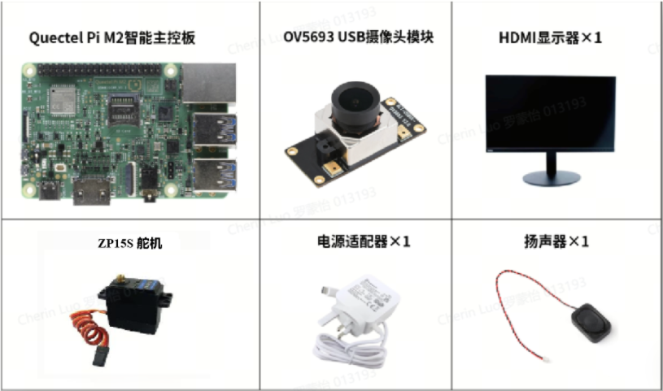
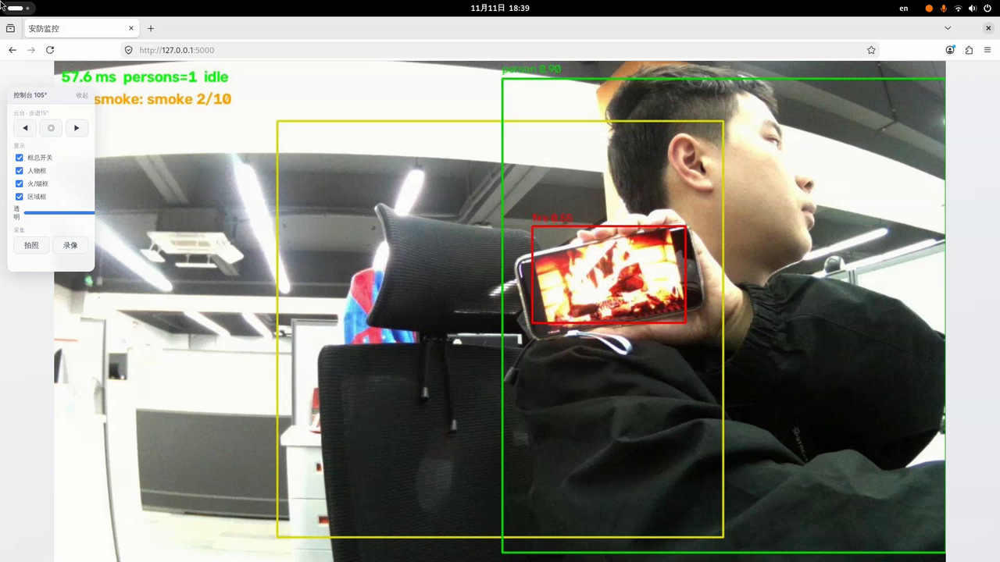
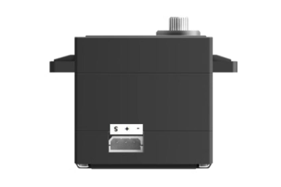

# 安防设备

[简体中文](README.zh-CN.md) | [English](README.md)

***Copyright © Quectel Wireless Solutions Co\., Ltd\. 2026\. All rights reserved\.***

---

# 修订记录

|版本|日期|作者|变更描述|
|---|---|---|---|
|\-|2026\-11\-11||文档创建|
|0\.1|2026\-11\-11||临时版本|

# 项目概述

本项目是一个基于 Quectel Pi M2 智能主控板、USB摄像头、舵机实现安全监控和火灾检测的示例。

项目基于python和Web界面，使用YOLO v8对开源数据集进行模型训练，能精准识别摄像头指定范围内的人物和火焰，并在达到指定警告时间后发出告警声音和记录前后一段时间的画面。同时也提供舵机实现摄像头视野范围调节。


# 开发资料

## 开发配件清单

> Note:tips
> 
> 开发配件只是作为参考，不同的开发环境可能会有所差异
> 
> 

|**配件名称**|**数量**|**规格或说明**|
|---|---|---|
|Quectel Pi M2 智能主控板|1 块|主控|
|USB UVC 摄像头|1 个|建议支持 1080p MJPG，通过 M2 的 USB 3\.0 接口接入|
|HDMI 显示器|1 台|桌面演示|
|USB 键盘鼠标|1 对|操作桌面 APP，可选|
|ZP15S舵机|1个|用于摄像头转动|
|电源适配器|1 个|按 Quectel Pi M2 的供电要求选择|
|有源音箱或扬声器|1 套|演示告警声音，可选|


## 配件实物参考



# 快速上手

## 开发准备

**Quectel Pi M2** 智能主控板出厂默认搭载 **Debian 13** 系统镜像，直接按照以下步骤即可开始开发。

## 硬件连接

1. **M2供电连接：USB\-C电源**

2. **模组连接**：

|**舵机**|**M2主板**|
|---|---|
|VCC \- 5V|PIN 4|
|GND|PIN 6|
|RX|PIN 8|

## 项目实现

### 获取代码

使用 git 克隆项目代码，以下是git仓库地址:

```Bash
git clone https://github.com/Quectel-Pi/demo-security-equipment.git
```

执行完成后，文件目录如下：

```Bash
demo-security-equipment/
├── README.md / README.zh-CN.md    
├── start.sh             入口
├── config.yaml          配置文件
├── src/                 
│   ├── main.py              
│   ├── camera/
│   │   └── capture.py       V4L2摄像头: 按名自动定位+活性探测
│   ├── vision/              
│   │   ├── pose_detector.py   人体姿态推理(跑yolo_pose.rknn)
│   │   └── fire_smoke.py      火焰/烟雾推理(跑dfire_yolov5s.rknn)
│   ├── logic/              
│   │   ├── intrusion.py       入侵判定: 区域滞留5s报警
│   │   └── fire_alarm.py      分级报警: 火焰连续命中/烟雾窗口计数/静态防误报保险丝
│   ├── io/                  
│   │   ├── alarm.py           报警输出: LED+喇叭
│   │   ├── stream.py          Web服务: 视频推流+API+控制台页面
│   │   └── recorder.py        取证: 抓拍/事件日志/报警前后短视频
│   └── servo/
│       └── servo_zp.py        ZP15S舵机驱动
├── models/              视觉模型
├── assets/              报警音(alarm.wav, 板端首次运行自动生成)
├── tools/               
│   ├── check_env.py         环境检查: 逐项验证python/依赖/摄像头/模型
│   ├── setup.sh             一键配置: 缺依赖自动装+uart1使能
│   ├── fire_lab.py          火烟模型现场测试: 逐帧score/位移统计
│   ├── peek_model.py        rknn模型解剖: 陌生模型验尺寸/输出格式
│   └── zp_test.py           舵机独立测试: 不启动主程序即可转动验证
└── records/(板端生成)    抓拍jpg/事件日志events.jsonl/取证录像rec/, 自动轮换      
```

### 验证环境

检查python、rknnlite*、*摄像头、numpy等环境。

```Bash
cd demo-security-equipment/

# 1.一键配置环境
sudo sh tools/setup.sh

# 2.检查配置：*逐项报 [OK]/[FAIL]: python版本/numpy/cv2/yaml/flask/rknnlite/摄像头/模型/config*
/opt/py312/bin/python3.12 tools/check_env.py
```

### 运行程序

执行程序后，打开浏览器地址即可看到画面：[http://127\.0\.0\.1:5000/](http://127.0.0.1:5000/)

```Bash
# 1.全量功能
sh start.sh

# 2.静音版
sh start.sh --no-alarm
```

### 文件配置

可通过config\.yaml修改必要参数，例如：

```Bash
# Web显示的框线参数
display:
  show_boxes: true              # 框线总开关: false=画面不画任何识别框(含区域框)
  show_person: true             # 人物框
  show_fire: true               # 火焰/烟雾框
  show_zone: true               # 布防区域框线(警告范围)
  line_width: 2                 # 框线线宽(想纤细改1)
  font_scale: 0.55              # 框上标签字号
  box_alpha: 1.0                # 框线不透明度 0.2~1.0 (0.6左右=半透明水印感)
  
# 录像
record:
  save_dir: records             # 抓拍jpg + events.jsonl
  enabled: true
  rec_dir: records/rec          # 录像输出文件夹(取证+手动; 可写绝对路径如 /userdata/rec)
  pre_s: 5                      # 报警前时长
  post_s: 5                     # 报警后时长
  fps: 10
  keep_files: 3                 # 取证录像只留最新3段, 第4段落盘自动覆盖最旧
  manual_keep: 15               # 手动录像只留最新15段(单段上限10分钟)
```

配置完毕后，重新启动 demo，强制刷新页面。

### 日志系统

本示例的日志分为**事件日志和视觉日志**：

**事件日志**包括：

1. 终端实时日志：启动程序后持续在终端打印信息

2. 文件存储日志：启动程序后会同步写到run\.log文件，每次启动后会覆盖上一次启动的日志内容

3. 事件josn日志：record/event\.josnl，只记报警事件，一行一条 JSON（时间/类型/置信度/坐标/抓拍文件名），追加不覆盖


**视觉日志**包括：

1. 事件取证：records/rec/evt\_\*\.mp4，**只留最新 3 段**，第 4 段自动删最旧

2. 预警抓拍：records/\*\.jpg，每次报警/每次点拍照各一张

3. 手动录像：只留 15 段，单段上限 10 分钟


## UI界面说明

主要有画面显示和控制台两个部分：

1. 控制台可通过左/归中/右按键分别调节摄像头角度；

2. 控制台可以选择是否开启屏幕的各种框线以及框线的透明度；

3. 控制台可以快捷采集照片或者录制一段视频；

4. 当人物由画面外走进画面中间（警告框）一段时间后，人物框线会由绿色变为红色，并触发报警；

5. 当画面中出现火焰时会框住火焰部分并在一段时间后触发报警。



## 舵机引脚介绍

ZP15S舵机由data和VCC、GND组成：data接入板子uart口负责读取信号，且从左到右分别是data、VCC、GND，若使用舵机厂家的接线，则有以下配对

橙/白色线\-\-\-\-\-\-\-\-\-\-\-\-\-\-\- data

红色线\-\-\-\-\-\-\-\-\-\-\-\-\-\-\-\-\-\-\- VCC

棕/黑色\-\-\-\-\-\-\-\-\-\-\-\-\-\-\-\-\-\- GND



# 常见问题及解决方案

## 摄像头识别火焰误报

本案例使用的摄像头分辨率较低，因此在某些过曝的情况下会导致摄像头异常识别到火焰、烟雾，更换更高清摄像头尝试即可解决，训练数据集来自开源社区，因此也可以直接替换成用户自己的训练模型。

# 技术支持与贡献

如在使用过程中遇到问题，欢迎在[移远官方论坛](https://forumschinese.quectel.com/c/quectel-pi/58)提交技术咨询，我们的技术支持团队将及时为您解答。

欢迎提交 Issue 反馈问题或 Pull Request 贡献代码改进！

